<div align="center">



**Монитор внешней поверхности атаки.**
Показывает, что о вашем домене видно снаружи, что в нём слабое и что изменилось с прошлого скана.

  

</div>

## Зачем это

Всё, что атакующий узнаёт о вас, не касаясь ваших серверов: поддомены из публичных журналов сертификатов, забытые DNS-записи, устаревшее ПО, служебные хосты, торчащие в интернет, слабая почтовая защита. `silhouette` собирает это в одну картину, ставит оценку A–F и при каждом новом скане показывает дифф: что появилось, что исчезло и что исправлено.

<div align="center">

<sub>дашборд на симулированном домене <code>corp.example</code> (зарезервированный TLD, реальных адресов нет): подставные DNS и сайты проходят через настоящий конвейер. Полная страница: <a href="assets/dashboard-full.png">dashboard-full.png</a></sub>
</div>

## Быстрый старт

```bash
python3 -m venv .venv && .venv/bin/pip install .
.venv/bin/silhouette scan example.org                           # пассивно
.venv/bin/silhouette scan example.org --probe --i-am-authorized  # с зондированием своего домена
.venv/bin/silhouette report example.org --min-severity medium
.venv/bin/silhouette report example.org --format html --output report.html   # или --format md, файл можно отправить человеку
.venv/bin/silhouette diff example.org                           # что изменилось с прошлого скана
.venv/bin/silhouette dashboard                                  # http://127.0.0.1:8090
.venv/bin/silhouette seed-demo --db data/demo.db                # симулированный домен для демо
```

**Для CI.** Чтобы проверка падала по порогу, добавьте `--fail-on` (есть ли в скане находки не ниже уровня) или `--fail-on-new` (появились ли новые по сравнению с прошлым сканом). Работает у `scan` и `report`:

```bash
.venv/bin/silhouette scan example.org --fail-on high            # код 3, если есть high и выше
.venv/bin/silhouette scan example.org --fail-on-new medium      # код 3, если появились новые medium и выше
```

Коды возврата: `0` порог не превышен, `1` ошибка скана, `2` неверные аргументы, `3` порог превышен. Причина выводится в stderr.

Без установки то же самое делает `python3 -m silhouette …`. Для разработки: `pip install -e ".[dev]"`, затем `pytest`, `ruff check .`, `mypy silhouette`.

**Вежливость к внешним сервисам.** Ответы crt.sh кэшируются на диск на 6 часов (`--cache-ttl`, `--no-cache`), запросы к нему идут не чаще одного в 1,5 секунды, а на ответы 429/503 инструмент ждёт столько, сколько указано в `Retry-After` (не дольше минуты), иначе повторяет с нарастающей паузой и случайной добавкой. Активные пробы ограничены `--rps` (по умолчанию 5 в секунду на весь скан, сколько бы ни было потоков).

## Что проверяется

| режим | проверка |
| :-- | :-- |
| **пассивный (по умолчанию)** | поддомены из логов Certificate Transparency (crt.sh), DNS-цепочки CNAME, **висячие CNAME и возможный захват поддомена** (GitHub Pages, Heroku, Azure, S3 и др.), внутренние адреса в публичном DNS, служебные имена (`jenkins`, `staging`, `grafana`…), SPF и DMARC корня домена, **DNSSEC** (подписана ли зона) и **CAA** (кто вправе выпускать сертификаты) |
| **активный (`--probe`)** | один `GET /` и чтение сертификата: технологии и версии в духе WhatWeb, известные проблемные версии (например Apache 2.4.49), HSTS/CSP/clickjacking/cookie-флаги, просроченные и скоро истекающие сертификаты, «ничейные» страницы сервисов, служебные хосты, отвечающие из интернета |

Результаты складываются в SQLite: оценка по хостам, граф связей хост → CNAME → IP, дифф между сканами.

## Безопасность и этика

- **Только свои домены или те, на проверку которых есть письменное разрешение.** Пассивный режим ходит к crt.sh и DNS-резолверу, а цель не затрагивает.
- Активный режим включается флагом `--probe` и **требует** `--i-am-authorized`, иначе инструмент отказывается работать.
- Зондирование сводится к одному `GET /` и проверке сертификата на хост, без перебора путей, без эксплуатации. Хосты с внутренними или документационными IP пропускаются. Редиректы не выполняются.

## Как проверялось

- 61 тест: разбор crt.sh и повторы при сбоях, цепочки CNAME и висячие записи, SPF/DMARC на шести сценариях, версии ПО, заголовки, граф, дифф между сканами, API дашборда и 404 на подозрительные пути.
- Сбои сети и ответов: Retry-After числом и датой, мусорный Retry-After, HTML вместо JSON, JSON не того вида, записи не-словари, огромные имена, повреждённый и просроченный кэш, попытка выйти из папки кэша через `../` в имени домена, таймауты и SERVFAIL у DNS, зацикленные CNAME, система без `resolv.conf` (клиент берёт публичные резолверы).
- Ограничение скорости проб проверяется на подменённых часах: каждая следующая проба стартует через 1/rps секунды.
- В CI на каждый коммит: `ruff`, `mypy` и тесты на Python 3.10, 3.12 и 3.14.
- Пока я проверял, нашёл ошибку: `ipaddress.is_private` в Python считает «приватными» ещё и документационные диапазоны, поэтому демо-адреса ложно помечались как внутренние. Проверка переписана на явные RFC1918, loopback и link-local.
- Дашборд выводит данные из внешнего мира только через `textContent`, и в тестах проверено, что строки вида `` хранятся как текст.

## Ограничения

- Живой запуск на реальном домене в этой версии я не гонял: источник crt.sh и сеть проверены только через подмену в тестах. Обработку отказов crt.sh покрывает тест повторов.
- Список сервисов для захвата поддоменов и таблица «проблемных версий» короткие и ручные. Это ориентир, а не база уязвимостей, и актуальность нужно проверять.
- Проверка «публичный IP» делается до запроса, а сам запрос заново резолвит имя: теоретически DNS может измениться между проверкой и запросом.
- Нет порт-скана и интеграции с Shodan/Censys. Это осознанно оставлено на следующую версию.

## Лицензия

MIT, см. [LICENSE](LICENSE).
